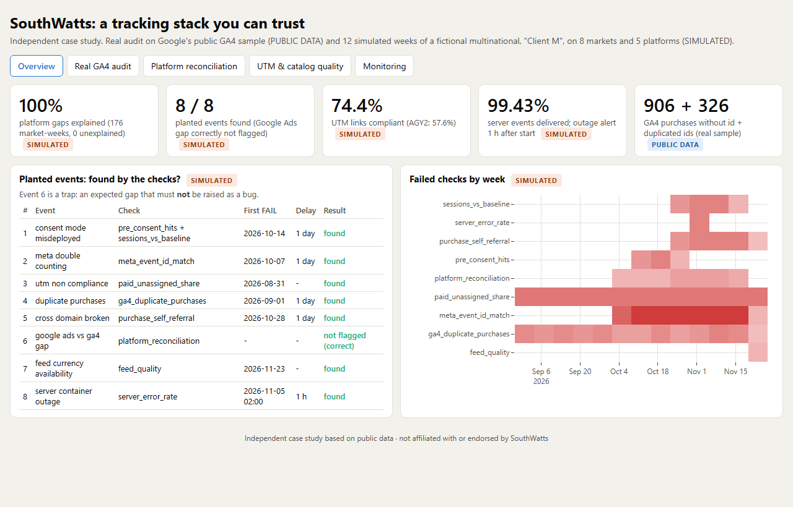

# SouthWatts: a tracking stack you can trust

**[Read the report (PDF)](https://albt-france.github.io/southwatts-tracking-audit-case-study/report/southwatts_tracking_case_study.pdf) · [Open the interactive dashboard](https://albt-france.github.io/southwatts-tracking-audit-case-study/dashboard/) · [Try the demo shop](https://albt-france.github.io/southwatts-tracking-audit-case-study/demo-shop/)**

<sub>Fallback links in this repository: [report PDF](site/report/southwatts_tracking_case_study.pdf) · [dashboard HTML](site/dashboard/index.html) (download and open) · [demo shop](site/demo-shop/index.html)</sub>

*Audit, fix and monitor measurement from the website to the ad platforms.* Independent case study for the
Tracking Specialist role at SouthWatts: a **real** GA4 audit on Google's public sample, a **tested** tracking setup
(tracking plan, dataLayer schema, GTM web and server templates, demo shop with browser tests), and the
reconciliation and monitoring of a **simulated** multinational client on 8 markets and 5 platforms.

## Key results

1. **Real GA4 sample (PUBLIC DATA)**: 906 of 5,692 purchase events have no usable `transaction_id`, 326 ids are sent
   twice (6.2% of purchase revenue counted twice, mostly reloads within a minute), and self-referral sessions hold
   **29.7%** of purchases until a one-day configuration change (22.1% of page views before 29 Dec 2020, 1.6% after).
2. **Gaps explained (SIMULATED)**: 176 market-weeks reconciled, **0 unexplained**. Google Ads +23% above GA4 is
   *expected* (attribution model, window, click date) and is not treated as a bug; Meta ×1.9 in France and Spain is
   a bug (pixel and Conversions API with different `event_id`).
3. **Monitoring (SIMULATED)**: 9 checks with documented thresholds found **all 8** planted problems (consent release,
   double counting, UTMs, duplicate purchases, cross-domain, feed, server outage) and correctly left the expected
   Google Ads gap alone. The night-time server outage is invisible in daily totals; the hourly check raised it after one hour.
4. **Tracking setup tested automatically**: 8 browser tests (Playwright) check consent order, schema, `ecommerce: null`,
   `event_id` reuse and a single `purchase` after reload; 13 SQL assertions guard the numbers, privacy and placeholder ids.



## What is in the repository

| Folder | Content |
|---|---|
| [`tracking/`](tracking/) | Tracking plan (`.xlsx`, `.md`), `datalayer.schema.json`, GTM **templates** (web, server; placeholder ids), architecture |
| [`site/demo-shop/`](site/demo-shop/) | Static shop with **no active tag**: pushes the plan's events to `window.dataLayer`, "simulate bugs" switch |
| [`tests/`](tests/) | Playwright tests of the dataLayer against the schema; `tests/report.html` |
| [`sql/`](sql/) | DuckDB queries 01-08 and `99_tests.sql`; [`sql/bigquery/`](sql/bigquery/) for the official GA4 export schema (`UNNEST(event_params)`) |
| [`src/`](src/) | Simulation, SQL runner, UTM and feed validators, monitoring, dashboard, notebook and PDF builders |
| [`utm/utm_builder.xlsx`](utm/) | Link builder with drop-down lists, formulas, mapping table and check sheet |
| [`docs/`](docs/) | Audit report, implementation guide, UTM governance, discrepancy playbook, feed checklist, monitoring runbook, agency onboarding, automation ideas, data issues log, assumptions |
| [`notebooks/tracking_audit.ipynb`](notebooks/tracking_audit.ipynb) | One executed notebook: audit → rulebook → plan → simulation → reconciliation → anomalies → monitoring |
| [`data/out/`](data/out/) | Aggregated outputs (no pseudonymous user id) |

## Methods

- **Real data**: Google Merchandise Store, obfuscated GA4 sample (BigQuery public dataset
  `ga4_obfuscated_sample_ecommerce`, 1 Nov 2020 - 31 Jan 2021), read from a flattened public mirror on Hugging Face
  (`gizdevans/ga4-bq-flattened-data`, MIT) because the official table needs a Google Cloud account. 2,065,852 events kept.
  It is Google's demo data, not a client.
- **Rulebook** (read 2026-11-25): GA4 recommended events, GA4 BigQuery export schema, GA4 Measurement Protocol,
  Meta pixel / Conversions API deduplication, Google tag gateway, Merchant Center product data specification,
  IAB TCF Global Vendor List v3 (v186, 1,240 vendors), CNIL rules on cookies and trackers. HTTP status and keyword checks
  in `data/reference/sources.csv`.
- **Simulation**: `src/simulate_tracking.py` (seed 42), fictional "Client M", 8 markets, 84 days, 4.1 million sessions,
  52,768 orders; GA4 export (reduced schema), server container deliveries, browser pixels, platform conversions,
  back office, agency links, product feed, deploy log. Hypotheses in [`docs/assumptions.md`](docs/assumptions.md).
- **Reconciliation**: expected ratio from 4 baseline weeks; a gap is anomalous only beyond 2 standard errors **and**
  with an independent diagnostic signal (consent break, self-referral share, `event_id` match, server errors).
- AI-assisted workflow: I used Claude, mainly to write scripts faster. I drove the project: I defined the questions, chose and validated the data sources, made the analytical decisions and checked every result.

## How to re-run

```bash
pip install -r requirements.txt
python -m playwright install chromium
python src/extract_ga4.py          # or copy an existing ga4_events_slim.parquet into data/raw/
python src/simulate_tracking.py
python src/run_sql.py
python -m pytest tests
python src/utm_validator.py
python src/feed_validator.py
python src/monitoring.py
python src/build_dashboard.py
python src/build_pdf.py
```

Optional: `python src/collect_refs.py` (re-reads the documentation pages, 1 request per second),
`python src/build_tracking_plan.py` (regenerates `tracking/`), `python src/build_notebook.py` (re-executes the notebook).
`build_dashboard.py` also refreshes the headline numbers (`data/out/key_numbers.json`) used by the PDF. The PDF needs Microsoft Edge or Chrome. No key or account is needed;
`.env.example` only documents the Measurement Protocol settings, which this project never calls.

**Import the GTM templates (in your own test account)**: see [`tracking/architecture.md`](tracking/architecture.md),
section "How to validate the templates".

## Sources

| Source | URL |
|---|---|
| GA4 public sample (mirror) | https://huggingface.co/datasets/gizdevans/ga4-bq-flattened-data |
| GA4 recommended events | https://developers.google.com/analytics/devguides/collection/ga4/reference/events |
| GA4 BigQuery export schema | https://support.google.com/analytics/answer/7029846 |
| GA4 Measurement Protocol | https://developers.google.com/analytics/devguides/collection/protocol/ga4 |
| Meta: deduplicate pixel and server events | https://developers.facebook.com/docs/marketing-api/conversions-api/deduplicate-pixel-and-server-events |
| Google tag gateway | https://developers.google.com/tag-platform/tag-manager/gateway |
| Merchant Center product data specification | https://support.google.com/merchants/answer/7052112 |
| IAB TCF Global Vendor List v3 | https://vendor-list.consensu.org/v3/vendor-list.json |
| CNIL, cookies and trackers | https://www.cnil.fr/fr/cookies-et-autres-traceurs/regles/cookies |
| Public holidays | https://date.nager.at |

## Limits

- The GA4 sample is obfuscated and partial: findings describe the sample, not a live store.
- Client M is fictional and its data is simulated. No internal data of SouthWatts or of its clients is used or guessed.
- Platform windows and models in the simulation are hypotheses; the GTM files are templates that were not imported
  into a real account; no account was created and no data was sent to any platform.
- Consent principles are cited from the CNIL; this is **not legal advice**.

---
Independent case study based on public data · not affiliated with or endorsed by SouthWatts
