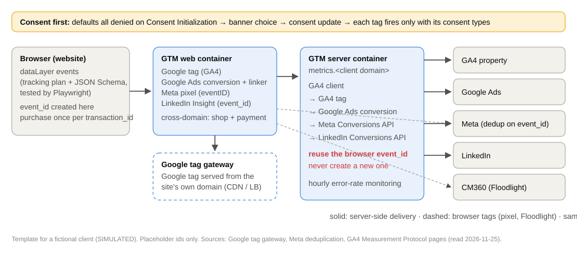
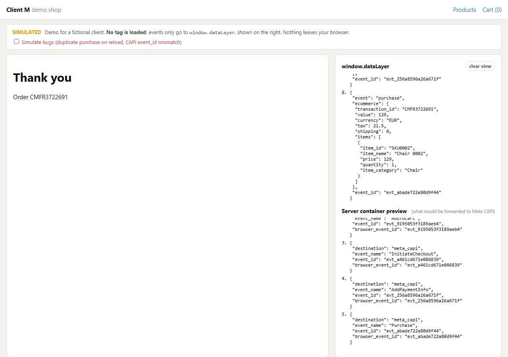

# Tracking architecture (template, fictional Client M)

| Layer | Role | Files |
|---|---|---|
| Website / dataLayer | Pushes the tracking plan events; creates `event_id`; `purchase` once per `transaction_id` | `tracking_plan.md`, `datalayer.schema.json`, `site/demo-shop/` |
| Consent | Defaults all `denied` before any tag; update on choice; each tag declares its consent types | `gtm_container_client.json` (tag 1, `consentSettings`) |
| GTM web container | Google tag, GA4 events, Google Ads conversion + linker, Meta pixel, LinkedIn Insight | `gtm_container_client.json` |
| Google tag gateway | Serves the Google tag from the site's own domain, set up on a CDN, load balancer or web server | infrastructure (not in the container) |
| GTM server container | First-party endpoint; forwards to GA4, Google Ads, Meta CAPI, LinkedIn CAPI with the **browser** `event_id` | `gtm_container_server.json` |
| Monitoring | Daily and hourly checks, PASS/WARN/FAIL | `src/monitoring.py`, `docs/monitoring_runbook.md` |

## Why each choice

- **Server container on a first-party subdomain**: fewer lost hits, one place to control what each platform receives
  (and to drop fields it must not receive).
- **Same `event_id` on both paths**: Meta deduplicates a pixel event and a server event that share `event_id` and the event
  name (Meta documentation, read 2026-11-25). Without it, the platform counts twice (simulation: FR and ES, ×1.9).
- **Google tag gateway**: Google presents it as a way to "serve scripts and send measurement in a first-party context"
  (<https://developers.google.com/tag-platform/tag-manager/gateway>, read 2026-11-25). The exact setup depends on
  the client's CDN; this project does not claim more than the page says.
- **Consent first**: CNIL (read 2026-11-25) states that consent must come before certain trackers are placed or read.
  Which trackers are exempt is a legal question for the client. Not legal advice.

## How to validate the templates (user action)

1. Create a free test GTM account and a test GA4 property (never a client account).
2. Admin → Import container → choose `gtm_container_client.json` → new workspace → **Merge**.
3. Replace the placeholders (`G-DEMO000000`, `AW-000000000`, Meta and LinkedIn ids) with the test property ids.
4. Preview mode on the demo shop served locally (`python -m http.server -d site/demo-shop 8000`), then go through
   the journey: each tag must fire once, and not before consent.
5. Server template: import into a test **server** container; add the Meta and LinkedIn Conversions API tags from the
   Template Gallery with `event_id = {{ED - event_id}}`.

The tag type identifiers follow the GTM export format as far as this project could check without an account; an
import error on a tag type is fixed by recreating that tag from the gallery.

## What the preview should show

The demo shop after a test purchase: every plan event in `window.dataLayer` (right, top) and the copy the server
container would forward to Meta CAPI (right, bottom), with the **same** `event_id` as the browser.

